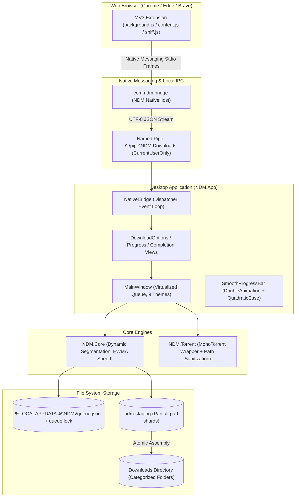

# AGENTS.md — NeoDM / N&T Architectural Guide & Agent Playbook

> **Important**: This document is the comprehensive single source of truth for AI agents, developers, and maintainers working on the **NeoDM** codebase (publicly branded as **N&T**). Read this document completely before modifying any code, tests, or documentation.

---

## 1. Executive Summary & Identity

**NeoDM** (user-facing product name: **N&T**, version `1.0.0`) is a high-performance, dependency-free, Windows-first download manager and torrent client.

### Core Architecture at a Glance
* **`src/NDM.Core`**: Zero-dependency, pure .NET 8 HTTP(S) multi-connection download engine. Handles dynamic segmentation, range validation, streaming I/O, atomic state serialization, and rate limiting.
* **`src/NDM.App`**: Modern Windows Presentation Foundation (WPF) desktop GUI application (assembly `NeoDM.exe`). Implements MVVM/Dispatcher data flow, a virtualized queue table, a 9-theme design system, custom smooth 60fps animations, modeless progress/completion views, and system tray integration.
* **`src/NDM.NativeHost`**: Stdin/stdout Chrome Native Messaging bridge executable (`com.ndm.bridge`). Relays download interception requests from Chromium browsers to the app's local named pipe.
* **`src/NDM.Torrent`**: Robust BitTorrent engine wrapping MonoTorrent 3.0.2 (MIT) with strict Windows path-traversal sanitization, magnet metadata resolution, and bandwidth scheduling.
* **`extension/`**: Manifest V3 browser extension for Google Chrome, Microsoft Edge, and Brave. Features automatic browser-download handover, smart session pause, and a closed Shadow DOM media sniffing ribbon.
* **`installer/`**: WiX 5.0.2 toolset installer generating per-machine enterprise MSIs (`NeoDM-Setup.msi`), shortcut management, and browser policy/host configuration scripts.

---

## 2. Inviolable Rules & Guardrails

### 2.1. Forbidden-Name Scan (Build Fails Hard)
* Every `build.ps1` execution scans all source files, documentation, markdown files, scripts, tests, and first-party binaries (`.exe`, `.dll`).
* **It throws and halts the build if it finds:**
  1. The whole word matching the legacy 3-letter acronym `'I'+'DM'` (case-insensitive).
  2. The exact phrase `'Internet Download '+'Manager'`.
  3. The fragment `'q'+'bit'`.
* **NEVER** write those exact strings anywhere in code, comments, docstrings, git messages, test fixtures, or docs. Refer to external tools generically as *"legacy download managers"* or *"third-party torrent clients"*.

### 2.2. Strict Version Discipline
When bumping or aligning versions:
1. Ensure `## [x.y.z] - YYYY-MM-DD` exists in `CHANGELOG.md` conforming to [Keep a Changelog](https://keepachangelog.com/en/1.1.0/).
2. Maintain `<Version>`, `<AssemblyVersion>`, `<FileVersion>`, and `<InformationalVersion>` in `Directory.Build.props`.
3. **Do not manually edit** `"version"` in `extension/manifest.json`: `build.ps1` automatically synchronizes it from `Directory.Build.props`.
4. `build-installer.ps1` cross-validates version consistency across `dist/app`, `Directory.Build.props`, and `CHANGELOG.md`.

### 2.3. The Build Gate (Local CI)
* There is **no remote CI server**; `build.ps1` is the single source of truth for build validation.
* **Run gate**:
  ```powershell
  powershell -NoProfile -ExecutionPolicy Bypass -File build.ps1
  ```
* Must exit with **code 0**. Runs all 14 C# test suites, 89 Node.js extension tests, publishes `dist/app` and `dist/host` (self-contained `win-x64`), packs `dist/NeoDM.crx`, verifies required DLLs (`NDM.Torrent.dll`, `MonoTorrent.Client.dll`), and executes the forbidden-name scan across all files.
* **Fast publishing during UI iteration**:
  ```powershell
  powershell -NoProfile -ExecutionPolicy Bypass -File build.ps1 -SkipTests
  ```

---

## 3. Deep Dive: Component Architectures



---

### 3.1. `src/NDM.Core` — HTTP(S) Engine

`NDM.Core` is an independent, pure .NET 8 library with zero NuGet packages or external runtime dependencies.

#### Download Coordination & Dynamic Segmentation
* **Range Probing**: The engine sends a probe request (`bytes=0-0`). It validates:
  - Exact `206 Partial Content` response with valid `Content-Range`.
  - Strong `ETag` or stable `Last-Modified` timestamp (>= 60s separation from `Date`).
  - If weak, missing, or rejected, it gracefully degrades to a single streaming connection without splitting.
* **Dynamic Range Splitting**:
  - Starts with up to `MaxSegments` (default: 4, configurable 1..32).
  - When one segment finishes and an engine worker slot is free, the coordinator finds the largest active range whose remaining tail exceeds `MinimumSegmentSize` (default: 256 KiB, min: 64 KiB).
  - It cancels the active worker asynchronously, flushes written bytes, divides the remaining tail in half, and dispatches re-requests for both segments without corrupting file offsets.
  - Shards are bounded to a maximum of 256 persistent parts per download job.
* **Telemetry & Speed Calculation**:
  - `SpeedBytesPerSecond`: Uses an **Exponentially Weighted Moving Average (EWMA)** with a 2-second time constant ($\alpha = 1 - e^{-\Delta t / 2}$) sampled every 600 ms via high-resolution `Stopwatch`. This absorbs momentary network spikes and eliminates jitter.
  - `RemainingTime`: Computed directly from the smoothed EWMA speed; yields `null` for unknown total lengths or non-downloading states, and `TimeSpan.Zero` upon completion.
* **Filesystem Safety & Staging**:
  - All partial pieces are saved in a hidden `.ndm-staging\<job-id>\` directory on the target volume.
  - File assembly reconciles part offsets with 64 KiB buffered sequential copies.
  - Upon completion, the file is atomically moved to the final destination. If a collision occurs, `FileNameResolver` reserves names using a clean numeric suffix (`(1)`, `(2)`).
  - `queue.json` is checkpointed via temporary write + `File.Replace`. Exclusive ownership is enforced with `queue.lock`.

---

### 3.2. `src/NDM.App` — Modern WPF Application

The desktop application (`NeoDM.exe`) provides a workspace focused on throughput, responsiveness, and clean aesthetics.

#### 1. Data Polling and Thread Marshalling
* `DownloadManager` runs on thread-pool threads and raises `Changed` events asynchronously.
* `MainWindow` subscribes to engine updates, buffers transitions, and uses a 500 ms `DispatcherTimer` to update the observable `ObservableCollection<DownloadRow>`.
* Row instances remain stable across ticks; properties only trigger `PropertyChanged` when displayable values actually change, avoiding unnecessary WPF visual tree invalidations.

#### 2. Visual Polish & Theming System
* **No Retro Aero Borders**: List rows and selection states use custom templates (`OverridesDefaultStyle=True`) with rounded corners (`BorderRadius=6`), high-contrast SVG glyphs, and theme-adaptive colors (`SurfaceHoverBrush`, `AccentFillBrush`).
* **9 Included Themes**: Light, Dark, System (syncs with Windows OS mode), Midnight (deep charcoal), Graphite, Ocean, Forest, Rose, Paper.
* **Accent Color Engine**: Users can pick any custom `#RRGGBB` hex color. The app automatically calculates contrast ratios and adjusts text foregrounds to maintain WCAG 4.5:1 readability.

#### 3. Smooth Progress & Numeric Animations
* Custom `SmoothProgressBar` control replaces standard jumpy WPF progress bars:
  - Uses `DoubleAnimation` over 150–200 ms with `QuadraticEase` (`EaseOut`).
  - Progress updates glide continuously between network chunk arrivals.
  - Byte numbers and speed meters are smoothed through EWMA telemetry to eliminate visual stutter.

#### 4. Dialog & Window Lifecycles
* **`DownloadOptionsDialog`**: Shown immediately when the browser captures a download. Features automatic category detection (Programs, Compressed, Music, Video, Documents) into dedicated subfolders, custom speed caps, and deferred scheduling.
* **`DownloadProgressWindow`**: Modeless inspection window rendering active segment maps, per-connection speeds, resume capability, and connection counts without stalling the main queue.
* **`CompletionController`**: Serializes completion announcements; prevents popup storms when batch downloads finish simultaneously. Safely handles file execution confirmations via Windows `SHOpenWithDialog`.
* **System Tray**: Powered by `Hardcodet.NotifyIcon.Wpf`. Minimizing or closing the window parks the app in the tray while downloads continue in the background.

---

### 3.3. `src/NDM.NativeHost` & IPC Bridge

* **Host Registration**: Registered under `HKCU\Software\Google\Chrome\NativeMessagingHosts\com.ndm.bridge` (also Edge and Brave).
* **Wire Protocol**: Standard Chrome Native Messaging stdio framing (4-byte little-endian message length prefix followed by UTF-8 JSON up to 64 KiB).
* **Named Pipe Bridge**:
  - Connects to `\\.\pipe\NDM.Downloads` created by `NDM.App` with `PipeOptions.CurrentUserOnly`.
  - Protocol: Single-line JSON request (`{"url": "...", "fileName": "...", "referer": "...", "cookie": "..."}\n`).
  - Response: Single-line JSON acknowledgement (`{"ok": true, "id": "..."}\n` or `{"ok": false, "cancelled": true}`).
  - 5-minute decision window: The extension cancels the browser download immediately, but waits up to 330 seconds for the user to confirm the desktop dialog. If the user cancels, the download is discarded; if the desktop app fails to reply, the extension restarts the browser's native download.

---

### 3.4. `src/NDM.Torrent` — BitTorrent Engine

* **Engine Core**: Wrapper around MonoTorrent 3.0.2 with zero modifications to `NDM.Core`.
* **State Management**: Persists active torrents in `%LOCALAPPDATA%\NDM\torrent\torrents.json` and MonoTorrent fast-resume cache files.
* **Security & Path Sanitization**:
  - Enforces `TorrentValidator.EnsureInside`: Rejects any torrent or file entry attempting path traversal (`..`, `C:\Windows`, absolute paths, alternate data streams `:stream`, or reserved Windows device names like `CON`, `PRN`, `AUX`, `NUL`).
  - Maximum `.torrent` file size cap: 8 MiB (`MaxTorrentFileBytes`).
  - Magnets: Pre-fetches metadata via DHT/PEX before creating disk structures.

---

### 3.5. `extension/` — Chromium Browser Extension

* **Manifest V3 Architecture**: Compatible with Chrome, Edge, Brave, and other Chromium browsers.
* **Media Sniffing**:
  - `background.js` listens to `webRequest.onHeadersReceived` for `video/*` and `audio/*` mime types.
  - Closed Shadow DOM isolation: floating overlays anchored gracefully to each individual `<video>` element on the page, updating on scroll, resize, and play.
  - Premium design system: obsidian glassmorphism (`rgba(15, 23, 42, 0.92)` + `backdrop-filter: blur(16px)`), crisp 1px borders, subtle ambient occlusion shadows, refined typography, and N&T emerald action pills (`#2da57d`), eliminating all tacky AI slop.
  - Fullscreen support: automatically reparents the shadow host into `document.fullscreenElement` so on-video download buttons remain accessible during full-screen playback.
  - Multi-video & headless compatibility: dynamically maps streams to their respective `<video>` elements, with automatic fallback to bottom-right docked containers in headless/JSDOM test environments or unattached media.
* **Key Pair & Permanent Extension ID**:
  - Extension ID: `hohmmojlhbkelkobobpkochpdempcihd` (recorded in `tools/extension-id.txt`).
  - Derived from the RSA-2048 public key embedded in `extension/manifest.json`.
  - Packed using `tools/pack-extension.cjs` into `dist/NeoDM.crx`.

---

### 3.6. `installer/` — WiX Packaging

* **WiX 5.0.2**: Builds `artifacts/NeoDM-Setup.msi`.
* **Properties**:
  - `Package Name="N&T"`, `Manufacturer="N&T"`.
  - Install Location: `C:\Program Files\N&T`.
  - UpgradeCode: `6B1F0C7E-4A52-4C0B-9B0E-2D5C7A1E9F31`.
  - `AllowSameVersionUpgrades="yes"` allows continuous iteration on the same version number during development without requiring version increments on every test install.
* **Custom Actions**:
  - `StopNeoDM`: Terminates active processes before file operations.
  - `LaunchNeoDM`: Relaunches the app under the non-elevated interactive user token after install/upgrade.
  - `LaunchExtSetup`: Spawns `install-extension.ps1` to assist the user in enabling the extension in their chosen browser.

---

## 4. Known Quirks, Edge Cases & Technical Debt

### 4.1. Test Harness Singleton Mutex Quirk
* In `NDM.App`, the `App` class constructor schedules `OnStartup` on the WPF Dispatcher.
* When writing or running UI tests that pump the WPF Dispatcher with an `App` instance, you **must subclass `App` and override `OnStartup`** (as done in `TestApp`).
* *Why*: If standard `OnStartup` runs during tests, it attempts to acquire the machine-wide singleton mutex (`Local\NDM.App`), detects another running instance, shuts down the test process, and unloads pack-URI schemas, causing sudden `UriFormatException: The URI prefix is not recognized` errors.

### 4.2. Chromium Extension Installation Restrictions
* Chromium forbids silent, automated installation of third-party `.crx` files outside the Chrome Web Store on unmanaged consumer machines.
* Dragging and dropping a `.crx` file triggers "CRX_REQUIRED_PROOF_MISSING" or disables the extension.
* *Solution*: The user must load the unpacked directory (`extension/` or `C:\Program Files\N&T\extension\unpacked`) via **Developer mode -> Load unpacked**, or use an enterprise policy allowlist. `installer/install-extension.ps1` provides an interactive dialog that copies the directory path to the clipboard and opens the browser's extension settings directly.

### 4.3. YouTube DASH Video/Audio Separation
* Modern video hosting platforms serve high resolutions (1080p, 4K, 60fps) using DASH/MSE with separate video-only and audio-only streams.
* Because `NDM.Core` does not embed heavy external transcoding libraries like FFmpeg, it cannot mux separate audio and video streams on the fly.
* *Behavior*: The extension flags audio-only or video-only streams with an informative badge and only offers progressive muxed formats (e.g. 720p/360p) as full files.

### 4.4. Atomic Queue Checkpointing vs. Filesystem Moves
* When a download completes, the staging file is moved to the destination directory, and `queue.json` is updated.
* If a sudden power loss occurs between file rename and queue flush, the file exists on disk, but the queue still thinks it was in progress.
* *Handling*: On the next boot, the engine validates the destination file; if already complete, it leaves the file intact and assigns a collision-free name rather than re-downloading or overwriting.

### 4.5. Elevated vs. Non-Elevated Contexts
* Windows MSI installers run elevated as `NT AUTHORITY\SYSTEM`.
* If the MSI launched the app directly, the app would run elevated, preventing standard user drag-and-drop and breaking per-user named pipe access from browsers.
* *Handling*: The installer delegates the launch command through Windows Explorer (`explorer.exe [INSTALLFOLDER]NeoDM.exe`), guaranteeing the app executes with the normal interactive user token.

---

## 5. Developer & Agent Cheat Sheet

### Essential Commands

| Task | Command |
|---|---|
| **Run Full Verification Gate** | `powershell -NoProfile -ExecutionPolicy Bypass -File build.ps1` |
| **Fast Compile / Skip Tests** | `powershell -NoProfile -ExecutionPolicy Bypass -File build.ps1 -SkipTests` |
| **Run C# Engine Tests** | `dotnet run --project tests/NDM.Tests/NDM.Tests.csproj -c Release` |
| **Run WPF Fidelity Tests** | `dotnet run --project src/NDM.App/Tests/Fidelity/NDM.App.FidelityTests.csproj -c Release` |
| **Run Extension Node Tests** | `node --test tests/extension-*.cjs` |
| **Pack Browser Extension** | `node tools/pack-extension.cjs` |
| **Build MSI Setup Installer** | `powershell -NoProfile -ExecutionPolicy Bypass -File build-installer.ps1` |
| **Run Core HTTP Benchmark** | `dotnet run --project tests/NDM.Tests/NDM.Tests.csproj -c Release -- --benchmark` |
| **Native Host Self-Test** | `dotnet run --project src/NDM.NativeHost -- --self-test` |

---

## 6. Conventions for Future Edits

1. **Keep Public Contracts Intact**: Do not alter `NDM.Core` public types (`DownloadManager`, `DownloadJob`, `DownloadRequest`) or their semantics without reviewing `src/NDM.Core/README.md`.
2. **Never Commit Git-Ignored Keys**: Keep `keys/neodm-extension.pem` private. If lost, the extension ID changes, requiring complete re-registration.
3. **Maintain Zero Warnings**: `TreatWarningsAsErrors` is strictly enforced on `NDM.Core` and `NDM.Torrent`.
4. **Preserve User Data**: Upgrades and reinstalls must never touch the user's download database or downloads folder under `%LOCALAPPDATA%\NDM`.
