<div align="center">


# NeoDM

**A free, open source download manager for Windows.**

Fast segmented downloads, a clean modern interface, torrents, and browser integration for Chrome, Edge and Brave.

[](https://github.com/unlimitedera/NeoDM/releases/latest)
[](LICENSE)
[](#installation)
[](https://dotnet.microsoft.com/)
[](https://github.com/unlimitedera/NeoDM/releases)

[**Download**](https://github.com/unlimitedera/NeoDM/releases/latest) · [Features](#features) · [Install](#installation) · [Browser extension](#step-2-install-the-browser-extension) · [Build](#building-from-source) · [Changelog](CHANGELOG.md)

<br>

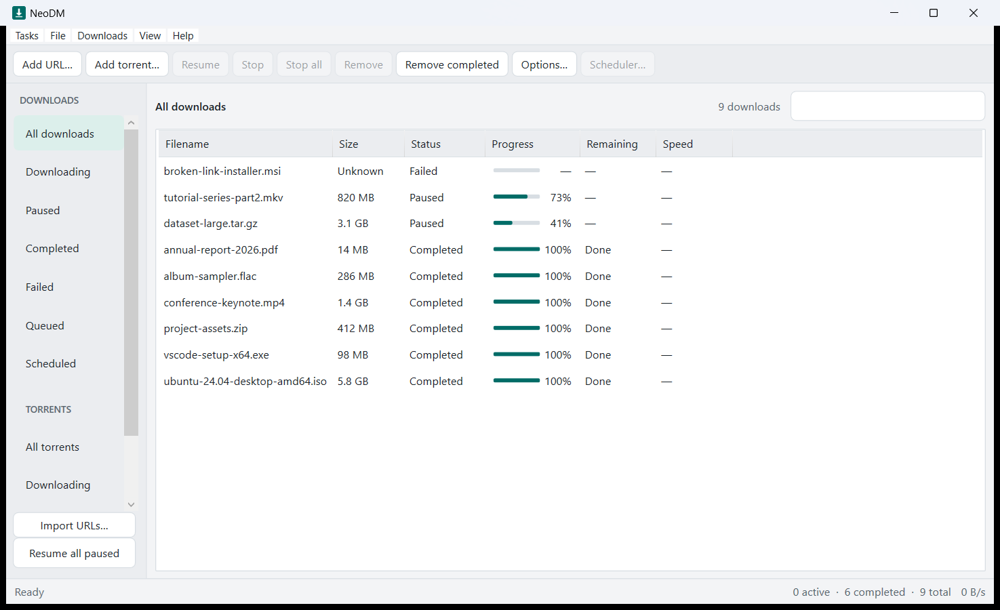

</div>

---

## Why NeoDM

- **Fast.** One file is split across up to 32 connections, and idle connections are given new work as others finish.
- **Reliable.** Pause and resume survive restarts, and changed files restart safely instead of being corrupted.
- **Complete.** HTTP/HTTPS downloads, torrents and magnet links, proxy support, scheduling and speed limits in one app.
- **Integrated.** A browser extension for Chrome, Edge and Brave catches downloads and detects videos on the page.
- **Private and free.** MIT licensed. No accounts, no telemetry, no licence checks, no ads.
- **Always there.** Runs quietly in the system tray, starts with Windows, and updates in place.

NeoDM is an open source project created by **unlimitedera**.

---

## Screenshots

| | |
|---|---|
|  | 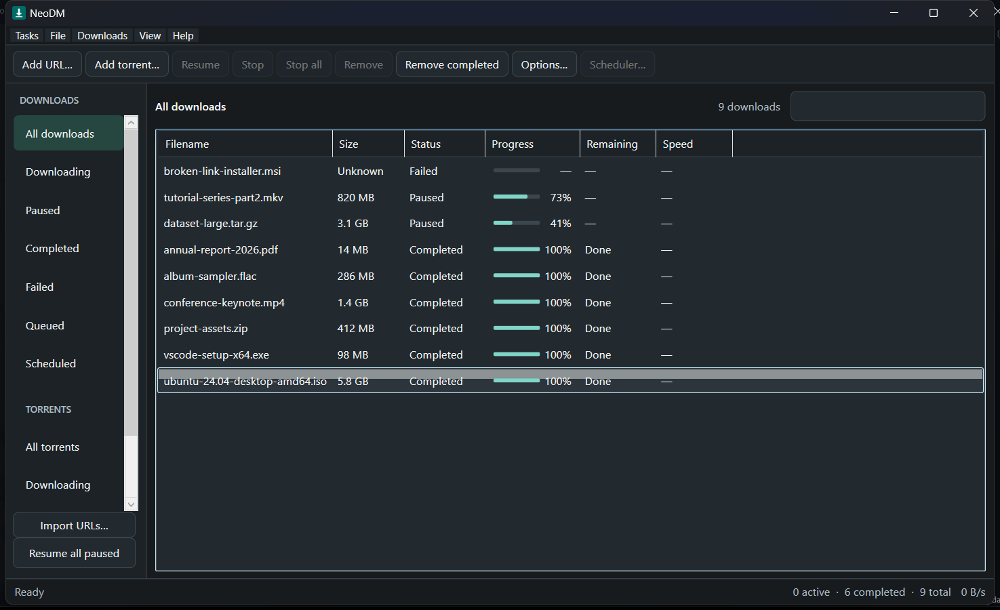 |
| Main window (light) | Main window (dark) |
| 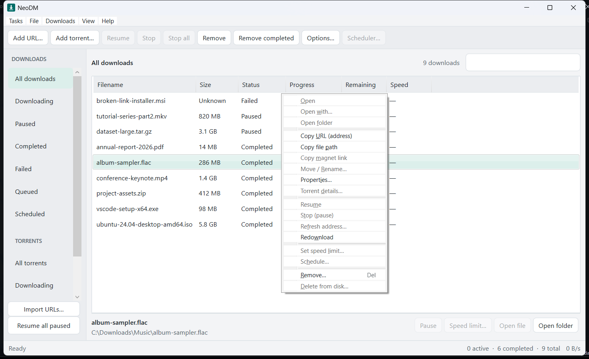 | 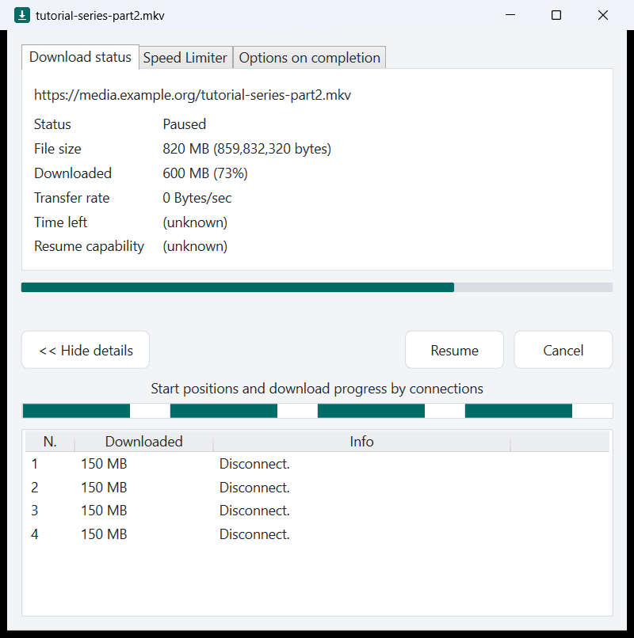 |
| Right-click menu on a download | Per-download progress window |
| 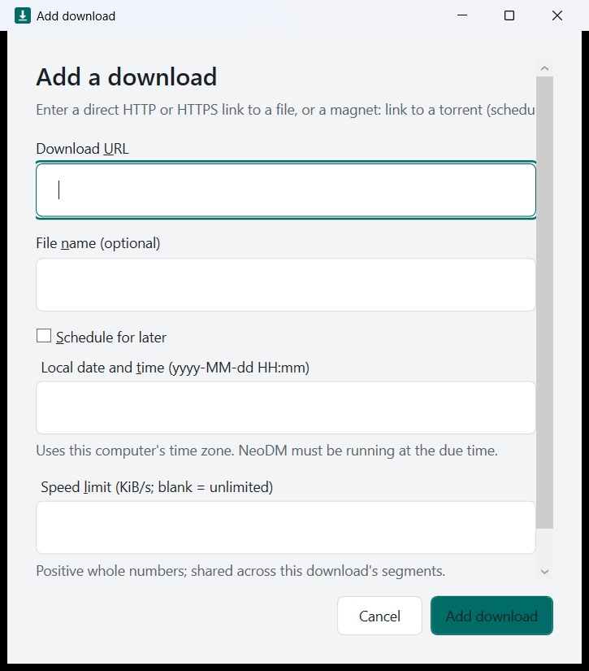 | 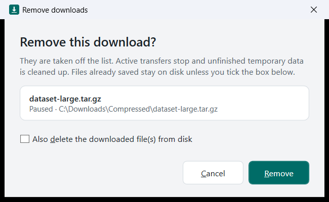 |
| Add a download (schedule, speed limit) | Remove dialog with optional file deletion |
| 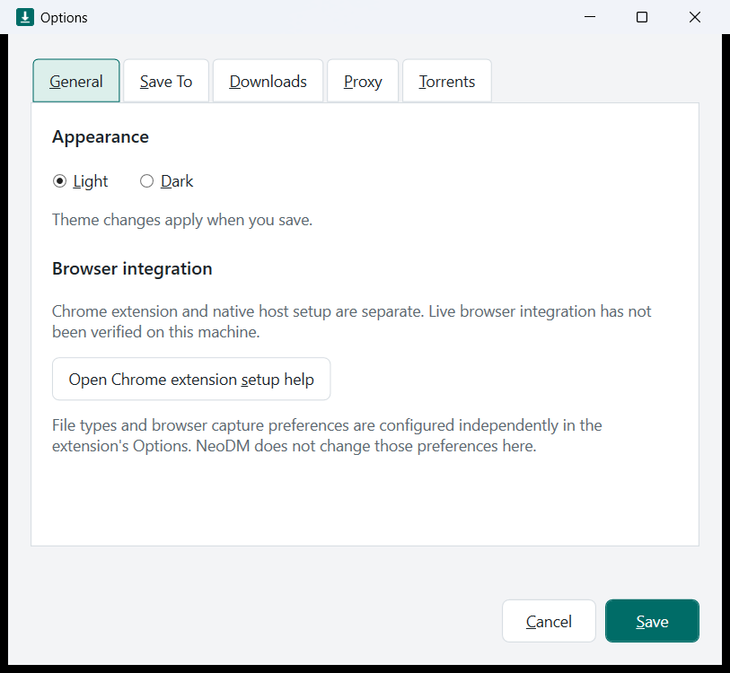 | 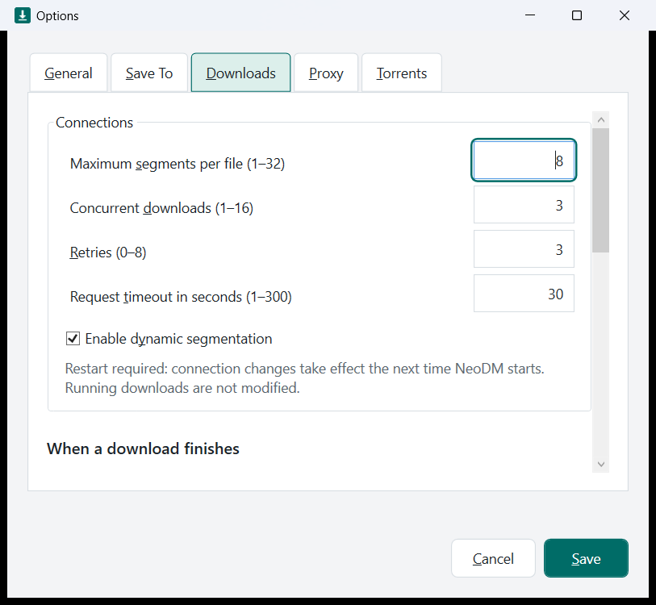 |
| Options: General | Options: Downloads and connections |
| 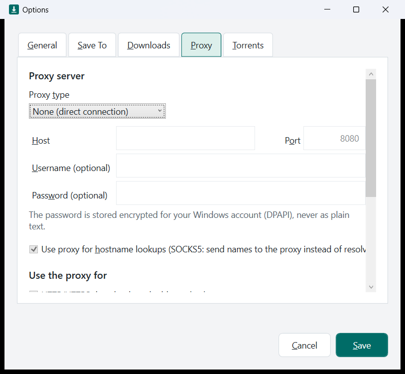 | 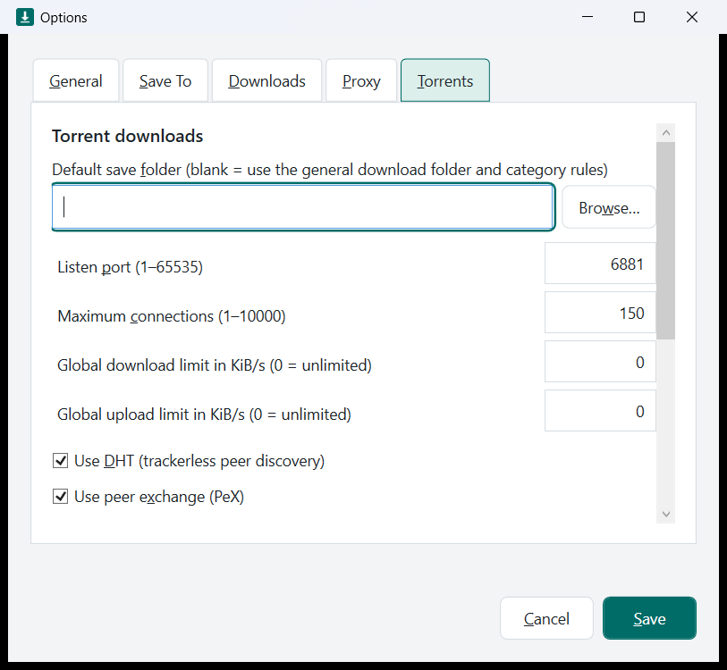 |
| Options: Proxy | Options: Torrents |
| 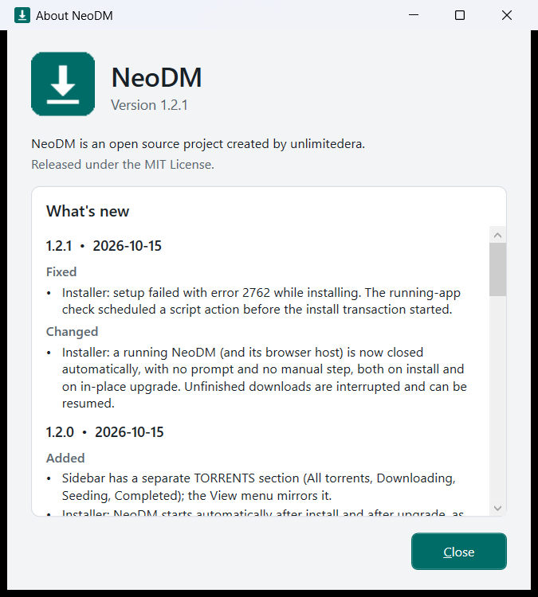 | |
| About window with version and changelog | |

---

## Features

### Download engine
- Segmented downloading: one file is split across several connections (1 to 32) to use more of your bandwidth.
- Dynamic segmentation: when a connection finishes early, the largest remaining part is split so idle connections keep working.
- Safe resume: pause and resume survive restarts. The file is validated against the server's identifiers, and a changed file restarts safely instead of being corrupted.
- Automatic fallback to a single stream for servers that do not support ranges.
- Smoothed speed, time remaining, resume capability and live per-connection telemetry.
- Retries, request timeouts, and a persistent queue that survives restarts.
- Concurrent downloads limit (1 to 16), per-download and per-job speed limits, and scheduling for a later time.
- Safe file names: unsafe characters are sanitised and name collisions never overwrite existing files.

### Interface
- Clean, modern interface with light and dark themes.
- Compact menus and toolbar, sortable download list, and a sidebar with filters (All, Downloading, Paused, Completed, Failed, Queued, Scheduled).
- A separate **Torrents** section (All torrents, Downloading, Seeding, Completed).
- Search, bulk URL import, Pause all / Resume all, Remove completed.
- Per-download progress window with three tabs: Download status, Speed Limiter and Options on completion. It shows the URL, status, size, downloaded, transfer rate, time left, resume capability and a per-connection table.
- Download complete dialog with Open, Open folder and Close.
- System tray icon. Closing the window keeps NeoDM running in the background; it starts with Windows and can be exited from the tray menu.

### File management
- Right-click menu on downloads: Open, Open with, Open folder, Copy URL, Copy file path, Move / Rename, Properties, Resume, Stop, Refresh address, Redownload, Set speed limit, Schedule, Remove, Delete from disk.
- Remove dialog with an optional checkbox to also delete the downloaded files from disk, or keep them.
- Category folders (on by default): downloads are sorted into **Programs, Compressed, Music, Video, Documents** subfolders of your Downloads folder, with customisable locations.

### When downloads finish
- Per-download options on completion: show the complete dialog, exit NeoDM, or turn off the computer (shut down, restart, sleep, hibernate, lock, with an optional force flag).
- Global completion actions, including playing a sound, opening the folder, running a program, and power actions.
- Every power action shows a countdown with a Cancel button first.

### Browser integration (Chrome, Edge, Brave)
- Capture downloads started in the browser and send them to NeoDM.
- When a download is captured, a dialog lets you **Start now**, **Add to queue** or **Schedule**, shows where the file will be saved and lets you change the folder. The progress window then stays open until you close or minimise it.
- Media ribbon on video and audio pages that offers to download the media it detects (direct media files; protected or segmented streams are not supported).
- Right-click menu entries to download links and media with NeoDM.
- Works through a native messaging host with a current-user-only connection to the app.
- Extension is Manifest V3, with a stable extension ID.

### Torrents
- Magnet links and `.torrent` files, with a file-selection dialog (per-file and per-folder checkboxes, Select all / Select none).
- Seeding, ratio, peers and seeds, per-file priorities, pause and resume, and a details window.
- Options: listening port, DHT, peer exchange, local peer discovery, UPnP / NAT-PMP, encryption, rate limits and connection limits.
- NeoDM registers itself as an available handler for `magnet:` links and `.torrent` files.
- Built on the MIT-licensed MonoTorrent library.

### Proxy
- None, HTTP, HTTPS or SOCKS5, with optional username and password.
- The password is stored encrypted for your Windows account (DPAPI), never as plain text.
- Test connection button, and separate scopes for HTTP/HTTPS downloads and torrent traffic.
- Limits: torrent DHT, local peer discovery, UPnP and UDP trackers are not sent through a proxy. They are switched off while a proxy is active, and incoming torrent connections stay direct.

### Installer
- Windows Installer package (`.msi`) with the NeoDM icon, Start Menu shortcut and optional desktop shortcut.
- Starts NeoDM when setup finishes, and with Windows.
- Upgrades an existing installation in place and keeps your settings and queue. A running NeoDM is closed automatically.
- Registers the native messaging host for Chrome, Edge and Brave.
- Always installs the extension files (`NeoDM.crx` and an unpacked copy) in the install folder.
- Optional browser policy install. This only works on managed PCs; see the browser notes below.

---

## Installation

### Requirements
- Windows 10 or 11, 64-bit.
- Administrator rights for the installer (it installs to Program Files).
- Nothing else. The .NET runtime is bundled.

### Step 1: Install NeoDM
1. Download `NeoDM-Setup-1.2.1.msi` from the [latest release](https://github.com/unlimitedera/NeoDM/releases/latest).
2. Double-click it and follow the wizard: Welcome, license, install folder (default `C:\Program Files\NeoDM`), then the **Browser extension** page.
3. On the **Browser extension** page, leave "Also install through browser policy" **unchecked** unless you manage your PCs with browser policies. On a normal PC the browsers block that route (see the extension section below).
4. Click Install and accept the Windows permission prompt. NeoDM starts by itself when setup finishes and appears in the system tray.

What the installer does: copies the app, registers the native messaging host for Chrome, Edge and Brave, adds NeoDM to Windows startup, creates a Start Menu shortcut (optional desktop shortcut), and places the browser extension files in `C:\Program Files\NeoDM\extension`.

**Updating:** run the newer installer over the old one. It upgrades in place, closes a running NeoDM for you, keeps your settings and queue, and starts the new version. Installing an older version over a newer one is refused.

**Silent install:**

```
msiexec /i NeoDM-Setup-1.2.1.msi /qn
```

Optional properties: `INSTALLFOLDER="D:\NeoDM"`, `RUN_AT_STARTUP=0`, `DESKTOP_SHORTCUT=1`, `INSTALL_POLICY=1`, `NO_LAUNCH=1`.

**Uninstall:** Settings, Apps, Installed apps, NeoDM, Uninstall. Your downloads are never deleted. Settings and the queue in `%LOCALAPPDATA%\NDM` are left in place.

### Step 2: Install the browser extension

The extension is what lets NeoDM catch downloads from your browser, show the download options dialog, and show the media ribbon on video pages. It works in **Chrome, Edge and Brave**.

Chrome, Edge and Brave refuse to install an extension that is not from their web store when it is added behind the browser's back on a normal (unmanaged) PC. They show "This extension is not listed in the Chrome Web Store and may have been added without your knowledge" and keep it disabled. So the reliable way is **Load unpacked**, which takes about a minute and works in all three browsers:

1. Make sure NeoDM is installed and running.
2. Get the extension folder:
   - **Installed with the installer:** use `C:\Program Files\NeoDM\extension\unpacked`. The Start Menu entry **Install NeoDM browser extension** opens this folder and your browsers' extension pages for you.
   - **Without the installer:** download `NeoDM-extension-unpacked.zip` from the [latest release](https://github.com/unlimitedera/NeoDM/releases/latest) and unzip it somewhere permanent, such as `C:\NeoDM-extension`. Do not delete or move this folder afterwards, because the browser loads the extension from it.
3. Open the extensions page in your browser:
   - Chrome: `chrome://extensions`
   - Edge: `edge://extensions`
   - Brave: `brave://extensions`
4. Turn on **Developer mode** (a switch at the top right in Chrome and Brave, at the left side in Edge).
5. Click **Load unpacked** and select the extension folder from step 2.
6. NeoDM Integration appears in the list and is switched on. Pin it from the puzzle-piece menu if you want its button in the toolbar.
7. Repeat steps 3 to 6 for each browser you use.

If you previously saw the "not listed in the Chrome Web Store" block, remove that old disabled entry first, then load the unpacked folder.

Chrome and Edge may show a "Disable developer mode extensions" notice when the browser starts. Dismiss it and keep the extension. Brave usually does not show it.

**Check that it works:**
1. Click the NeoDM Integration button in the toolbar and press **Test connection**. It should say "Host connected." If it says the native host is unavailable, make sure NeoDM is installed and running.
2. In the same popup, tick **Capture browser downloads** to let NeoDM take over your browser's downloads. It is off by default.
3. Download any file. The NeoDM dialog should appear with **Start now**, **Add to queue** and **Schedule**, the save location, and a Browse button.
4. Make sure **Show media ribbon on pages** is ticked in the popup, then open a page with a video. A NeoDM ribbon or button appears on supported direct media so you can download it. Protected or segmented streams are not supported.
5. You can also right-click any link and choose **Download link with NeoDM**.

**Cookies:** if a site needs your login to download, tick **Include authentication cookies** in the extension popup. The browser asks for permission, and cookies are only passed to NeoDM for that download and are never logged.

**Other ways to install:**
- **`NeoDM-extension.crx`:** this is the packed extension, included in the install folder and the release assets. Chrome, Edge and Brave do not accept it by drag and drop on a normal PC. It is meant for managed environments that deploy extensions by policy.
- **Browser policy option in the installer:** the checkbox on the Browser extension page (or `INSTALL_POLICY=1` for silent installs) writes the browser's force-install policy. It only takes effect on domain-joined or managed PCs, and the browsers then show "Managed by your organization".

**Troubleshooting**

| Problem | What to do |
|---|---|
| Extension is greyed out with the web store warning | Remove it and use Load unpacked as above. |
| "Native host unavailable" in the extension | Start NeoDM, then retry. If it persists, reinstall NeoDM so the native host registration is refreshed. |
| Downloads are not captured | Tick **Capture browser downloads** in the extension popup, and make sure NeoDM is running (check the system tray). |
| Extension disappeared after moving the folder | Browsers load the extension from the folder you picked. Put the folder back, or load the new location. |
| Installer asks to close NeoDM | It closes it automatically. Unfinished downloads are interrupted and can be resumed. |

## Project layout

| Path | What it is |
|---|---|
| `src/NDM.Core` | Download engine: segmenting, resume, queue, proxy, scheduling. No third-party dependencies. |
| `src/NDM.App` | The WPF desktop application (`NeoDM.exe`). |
| `src/NDM.NativeHost` | Native messaging host that connects the browser extension to the app. |
| `src/NDM.Torrent` | Torrent engine wrapper around MonoTorrent. |
| `extension/` | The Manifest V3 browser extension (source). |
| `installer/` | WiX installer sources and setup scripts. |
| `tools/` | Extension packing (CRX) and icon generation. |
| `tests/` | Engine, torrent and extension tests, plus an end-to-end check. |
| `docs/` | Design, browser, torrent and versioning notes. |
| `CHANGELOG.md` | Version history. |

## Building from source

Requirements: Windows, .NET 8 SDK, Node.js (for the extension tests), PowerShell, and the WiX tool (`dotnet tool install --global wix --version 5.0.2`) for the installer.

```
powershell -NoProfile -ExecutionPolicy Bypass -File build.ps1          # build, run every test suite, publish to dist\
powershell -NoProfile -ExecutionPolicy Bypass -File build-installer.ps1 # build artifacts\NeoDM-Setup.msi
```

The extension is packed with `node tools/pack-extension.cjs`. It signs with a private key in `keys/neodm-extension.pem`, which is **not** part of the repository. Generate your own key if you rebuild the CRX; the extension ID follows the key in the manifest.

Version and release notes follow `docs/VERSIONING.md`: every change bumps the version in `Directory.Build.props` and adds a `CHANGELOG.md` entry.

## Data and privacy

- Settings and the queue live in `%LOCALAPPDATA%\NDM`.
- NeoDM has no telemetry, no accounts and no licence checks.
- Cookies are only sent from the browser to NeoDM if you enable that option in the extension, and are never logged.
- Proxy passwords are encrypted with Windows DPAPI for your account.

## Known limitations

- Windows only.
- HTTPS-proxy connections have not been tested end to end (HTTP and SOCKS5 have).
- Torrent DHT, local peer discovery, UPnP and UDP trackers are not routed through a proxy.
- The media ribbon works on direct media URLs. Encrypted, blob, HLS and DASH streams are not captured.
- The installer's in-place upgrade, silent-mode behaviour and file-type association paths were verified from the package tables but not exercised on a clean machine.
- Live Chrome, Edge and Brave capture has been verified with mocked browser APIs and a real native-host exchange, not with an automated real browser session.

## Releases

| Version | Date | Highlights |
|---|---|---|
| 1.2.1 | 2026-10-15 | Fixed an installer error (2762); running NeoDM is now closed automatically during install and upgrade. |
| 1.2.0 | 2026-10-15 | Torrents section, torrent file selection fix, category folders on by default, installer icon, auto-launch, in-place upgrades. |
| 1.1.0 | 2026-10-15 | Torrents, proxy, remove-with-delete dialog, right-click menu, category folders, tabbed progress window, completion actions, installer, About window. |
| 1.0.0 | 2026-09-20 | Initial release: queue, segmented engine, modern interface, browser extension with media ribbon, tray. |

See `CHANGELOG.md` for details.

## License

MIT License. Copyright (c) 2026 unlimitedera and NeoDM contributors. Third-party components keep their own licenses (MonoTorrent and its dependencies are MIT licensed).
